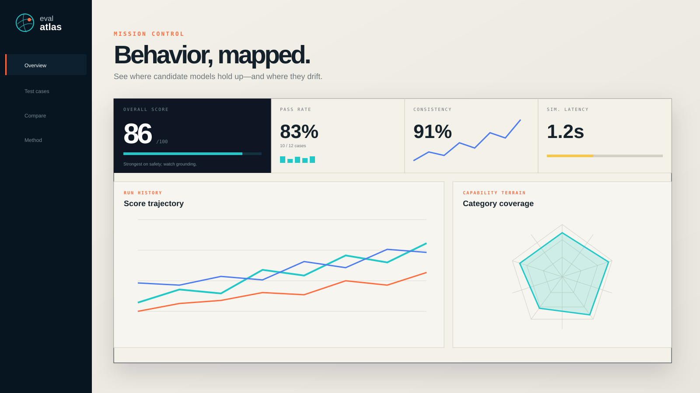
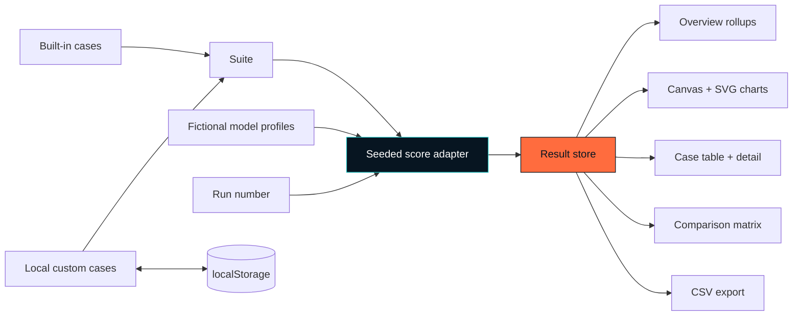

<div align="center">
  
  <br /><br />
  <h1>Eval Atlas</h1>
  <p><strong>Behavior, mapped.</strong></p>
  <p>A portfolio-grade evaluation dashboard for exploring test suites, model trade-offs, category coverage, and run history using honest, deterministic demo data.</p>
  <p>
    
    
    
    
  </p>
</div>

> **Demo-data boundary:** Eval Atlas does not call, host, benchmark, or evaluate any real model. “Aster-7B,” “Nova-Mini,” and “Orchid-2” are fictional. Every score and latency is generated by deterministic browser code for interface prototyping.

## The problem

Evaluation results are easy to flatten into one leaderboard number. That hides the questions that matter: Which behaviors fail? Are failures concentrated in one category? Does the winner change by use case? Which test should a team inspect next?

Eval Atlas is a product-design exploration of those questions. It makes a test suite browsable, comparison multi-dimensional, and every simulated run explicit about its provenance.

## Features

- **Mission-control overview** with overall score, pass rate, consistency, illustrative latency, and contextual signals.
- **Responsive charts** built from browser Canvas, SVG, and CSS—no charting library.
- **Capability radar** across reasoning, safety, format, grounding, and instruction-following.
- **Searchable test suite** with category/result filters, sorting, and detailed case drawers.
- **Model comparison plate** with category metrics, a result matrix, and up to three selected candidates.
- **Add-your-own cases** stored locally and included in the next simulated run.
- **Seeded run animation** that recalculates stable illustrative results from case, model, category, difficulty, and run number.
- **CSV export** of the current primary-model result set.
- **Method page** that clearly explains the data boundary and why demo scores are not a benchmark.
- **Accessibility basics** including semantic tables, visible focus, skip navigation, keyboard-closeable overlays, reduced motion, and mobile navigation.

## Architecture



Scores are a pure function of a case ID, fictional model ID, run number, category profile, and difficulty penalty. The UI derives pass rates, category means, consistency, rankings, and insights from those per-case values.

## Quick start

```bash
git clone https://github.com/harshareddy0405/eval-atlas.git
cd 07-eval-atlas
python3 -m http.server 8080
```

Open [http://localhost:8080](http://localhost:8080). No dependency install, build command, backend, account, or API key is needed.

## Usage

1. Choose a primary model on **Overview** and inspect how the rollups, radar, category bars, and signal change.
2. Open **Test cases** to search, filter, sort, and inspect individual results across all three candidates.
3. Add a case with a category, difficulty, and evaluation goal.
4. Select **Run eval** to advance the local run seed and recalculate the suite.
5. Use **Compare** to toggle candidates and find category or case-level divergence.
6. Export the primary model's current results as CSV.
7. Read **Method** before adapting the interface to real evaluation data.

## Replacing the simulator

The seam to replace is `scoreCase()` in `app.js`. A production version could ingest signed JSON from an evaluation harness or call an authenticated backend. Keep raw cases, rubric metadata, judge provenance, repetitions, uncertainty, errors, and timestamps—not just aggregate scores.

Before using real data, add:

- documented rubrics and threshold rationale;
- repeated trials and confidence intervals;
- human review for subjective or safety-critical criteria;
- dataset versioning and leakage controls;
- clear separation between model output, judge output, and analyst interpretation;
- authentication and server-side secret handling.

## Project structure

```text
07-eval-atlas/
├── assets/
│   └── cover.svg       # Repository hero artwork
├── app.js              # Cases, simulator, rollups, charts, exports
├── index.html          # Dashboard, tables, dialogs, method notes
├── styles.css          # Cartographic responsive visual system
├── README.md
├── LICENSE
└── .gitignore
```

## Local-first & privacy

- No prompt text or evaluation data leaves the browser.
- Custom cases, selected models, and the current run live in `localStorage`.
- The app contains no trackers, analytics, runtime dependencies, or network requests.
- CSV files are created locally with the browser's `Blob` API.
- Browser site-data removal clears custom cases. Export anything you need elsewhere.

## Roadmap

- [ ] JSON import adapter for external harness results
- [ ] Repeated-trial distributions and confidence intervals
- [ ] Rubric editor with weighted criteria
- [ ] Case tags, suites, owners, and version history
- [ ] Regression alerts against a pinned baseline
- [ ] Human-review queue and inter-rater agreement view
- [ ] Accessible data-table alternative for every chart

## Contributing

Pull requests are welcome, especially those that make evaluation uncertainty clearer rather than merely adding more metrics. Preserve the explicit simulated-data labeling unless a real, documented adapter has been implemented.

1. Fork the repository and create a narrow branch.
2. Serve the static site locally.
3. Test all four pages, filters and sorting, custom-case creation, detail drawers, simulated runs, resize behavior, and CSV export.
4. Include screenshots or a concise interaction recording for visual changes.
5. Explain any new metric's meaning and failure modes in the pull request.

## License

Released under the [MIT License](LICENSE).

## Built to be inspected

[](https://github.com/harshareddy0405/eval-atlas/actions/workflows/ci.yml)

The project includes versioned source, guarded local persistence, malformed-data recovery, product-specific interaction tests, and automated accessibility semantics checks. No API key is required to explore it.

```bash
# Optional development checks; the app itself needs no installation
npm ci --ignore-scripts
npm run check
npm test
npm run format:check
```

[Engineering notes](docs/ENGINEERING.md) · [Contributing](CONTRIBUTING.md) · [Security & privacy](SECURITY.md)

**Scope:** Scores are synthetic and the model names are fictional. This is evaluation-interface design, not evidence of model performance.
